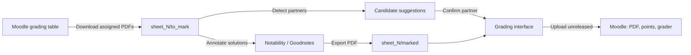

# LMU Moodle Grading Assistant

This application automates grading workflows for Moodle assignments on iPad, macOS, Linux, and Windows. It downloads submissions, matches submission partners, and records grades alongside annotated PDFs.

The project originated for tutors in the 2026-2027 Analysis 1 course at LMU Munich on `moodle.lmu.de`. Students submit exercises in pairs, with only one partner uploading the file. The tool identifies the partner from the document header, assigns points to both students, and records the tutor as the allocated grader.

The workflow operates on iPad within [a-Shell](https://holzschu.github.io/a-Shell_iOS/) using Notability or Goodnotes. The scripts adapt readily to other courses with pair submissions.

---

## Table of Contents

- [Overview](#overview)
- [How It Works](#how-it-works)
- [Requirements](#requirements)
- [📱 Installation on iPad](#-installation-on-ipad)
  - [1. Install a-Shell and dependencies](#1-install-a-shell-and-dependencies)
  - [2. Place scripts in iCloud Drive](#2-place-scripts-in-icloud-drive)
  - [3. Launch the application](#3-launch-the-application)
  - [4. Create a Home Screen shortcut](#4-create-a-home-screen-shortcut)
- [Installation on a Computer](#installation-on-a-computer)
- [🔎 Finding Moodle Settings](#-finding-moodle-settings)
- [✍️ Weekly Workflow](#️-weekly-workflow)
  - [Marking with Notability](#marking-with-notability)
  - [Marking with Goodnotes](#marking-with-goodnotes)
- [Features in Detail](#features-in-detail)
- [Command Line Interface](#command-line-interface)
- [Folder Layout](#folder-layout)
- [🔒 Privacy and Security](#-privacy-and-security)
- [Troubleshooting](#troubleshooting)
- [Development](#development)
- [License](#license)

---

## Overview

| Task | Manual process | Automated process |
| --- | --- | --- |
| Download | Browse grading tables, download submissions individually, rename files | Downloads all assigned submissions in one batch with clean names |
| Partner matching | Inspect headers manually, search course participant rosters | Identifies partners via PDF text and OCR, ranking roster candidates |
| Feedback upload | Open student profiles individually, upload annotated files | Uploads annotated PDFs in a single bulk feedback operation |
| Grade entry | Enter points manually for each partner, assign grader | Records points and grader for both partners simultaneously |

Grades remain unreleased in Moodle until course staff releases them manually.

---

## How It Works



The application runs a local web service on `127.0.0.1:8765`. On iPad, the interface loads inside a-Shell's internal browser without network exposure.

---

## Requirements

- LMU user account with tutor grading permissions in the target Moodle course.
- iPad: [a-Shell](https://apps.apple.com/app/a-shell/id1473805438) and Notability or Goodnotes.
- Desktop computer: Python 3.9 or newer.
- Python dependencies from [`requirements.txt`](requirements.txt): `requests`, `beautifulsoup4`, `pypdf`, `certifi`.

---

## 📱 Installation on iPad

### 1. Install a-Shell and dependencies

1. Install **a-Shell** from the App Store.
2. Open a-Shell and run:

   ```bash
   pip install requests beautifulsoup4 pypdf certifi
   ```

### 2. Place scripts in iCloud Drive

1. Download the repository archive from GitHub or clone via `lg2 clone https://github.com/flyingpalli/correct.git`.
2. Store the scripts in a dedicated folder in iCloud Drive, such as `iCloud Drive/LMU_Grading`.
3. The directory requires four core files:
   - `gui.py`
   - `cli.py`
   - `moodle_client.py`
   - `pdf_processor.py`
4. In a-Shell, link the folder:

   ```bash
   pickFolder
   ```

   Select the `LMU_Grading` folder.
5. Create a bookmark for direct access:

   ```bash
   bookmark icloud
   ```

   The command `showmarks` lists saved bookmarks.

### 3. Launch the application

```bash
cd ~icloud
python3 gui.py
```

The interface opens in a-Shell's internal browser at `http://127.0.0.1:8765/`.

> [!NOTE]
> When using Safari, keep a-Shell open in Split View or Slide Over. If Safari occupies the entire screen, iPadOS suspends background execution.

### 4. Create a Home Screen shortcut

The iOS Shortcuts app launches the server without terminal commands:

1. Open **Shortcuts**. Tap **+** and name the action **LMU Grading**.
2. Add the a-Shell action **Execute Command**.
3. Set the command:

   ```bash
   cd ~icloud && python3 gui.py
   ```

4. Enable **Open App** (or **Run in App**).
5. Open the shortcut options and select **Add to Home Screen**.

---

## Installation on a Computer

```bash
git clone https://github.com/flyingpalli/correct.git
cd correct
python3 -m venv .venv
source .venv/bin/activate        # Windows: .venv\Scripts\activate
pip install -r requirements.txt
python3 gui.py                   # or: python3 cli.py gui
```

The system browser opens `http://127.0.0.1:8765/`. To specify a different port, use `python3 cli.py gui --port 9000`.

---

## 🔎 Finding Moodle Settings

Settings persist across sessions in `settings.json`.

### Moodle course ID

1. Open the course page on `moodle.lmu.de`.
2. The browser address bar shows:

   ```
   https://moodle.lmu.de/course/view.php?id=48957
   ```

3. The integer following `id=` represents the course ID (`48957` by default).

### Assignment lookup

The client searches the course page automatically for titles matching `Übungsblatt <N>` or `Blatt <N>`, including zero-padded numbers such as `Blatt 03`.

For unusual titles, specify the course module ID (cmid) directly:

1. Open the assignment on Moodle (`https://moodle.lmu.de/mod/assign/view.php?id=2672327`).
2. The number after `id=` is the cmid. Pass it via CLI: `python3 cli.py download -s 3 --cmid 2672327`.

### Marker name (Bewerter)

The client reads the tutor name from the Moodle profile upon login and isolates matching rows in the grading table.

If the grading table uses an alternative name spelling, enter it in **Bewerter Name in Moodle (Optional Override)**. When no rows match, the error output prints all active marker names found in the table.

### Storage folder

The storage path determines where submissions, annotated files, and grade sheets reside. Paths resolve relative to the repository directory.

| Path | Description |
| --- | --- |
| `./sheets` | Default relative folder next to the scripts. |
| `~icloud/sheets` | Folder referenced via the a-Shell bookmark. |
| `/path/to/folder` | Absolute filesystem path on desktop systems. |

---

## ✍️ Weekly Workflow

The graphical interface organizes work into three sequential cards:

1. **Sign-In:** Enter LMU credentials (`username@campus.lmu.de`). Apple Passwords fills stored credentials with Face ID or Touch ID.
2. **Sheet and Folder Setup:** Set the sheet number. Select **Save Folder & Load Sheet**, then **Download Assigned PDFs**. Submissions arrive in `sheet_<N>/to_mark/`.
3. **Annotation:** Annotate the PDFs in Notability or Goodnotes.
4. **Partner Review and Upload:**
   - Select **Refresh Files** to verify marked files.
   - Select **Detect Partners (PDF + OCR)**. Confirm candidate suggestions and adjust via autocomplete if required.
   - Enter points and select **Save Partners & Points**.
   - Select **Review & Upload to Moodle**. Optionally execute **Run Dry-Run Check**, then confirm upload.

### Marking with Notability

1. Open `sheet_<N>/to_mark/` in the Files app.
2. Select all PDFs and share them to Notability, or drag them across in Split View.
3. Annotate the submissions with Apple Pencil.
4. Export notes via **Share > PDF > Save to Files** into `sheet_<N>/marked/`. Preserve original filenames.

### Marking with Goodnotes

1. Import PDFs from `sheet_<N>/to_mark/` into Goodnotes.
2. Annotate the submissions.
3. Export documents via **Share > Export > PDF** with annotations enabled. Save into `sheet_<N>/marked/`.

> [!IMPORTANT]
> Exported filenames must start with the original base name, such as `JDoe_sheet3`. Appending scores, for instance `JDoe_sheet3_14.5p.pdf` or `JDoe_sheet3-18pts.pdf`, extracts points automatically. Direct inputs in the interface table take precedence.

---

## Features in Detail

### Submissions download

- Clears sticky table filters before reading the full grading table.
- Retains rows assigned to the authenticated tutor by ID or name.
- Merges multi-file submissions into a single consolidated PDF per student.
- Normalizes filenames to `[FirstInitial][Lastname]_sheet[N].pdf`, appending suffixes on name collisions.
- Writes a sheet manifest linking local files with Moodle user IDs and participant IDs.
- Caches the complete course roster in `course_roster_<course_id>.json` across sheets.

### Partner recognition

Submissions typically list both student names alongside 8-digit LMU matriculation numbers on page 1. The detection pipeline processes this layout:

1. **Text extraction:** Extracts embedded text from the top of the initial pages via `pypdf`.
2. **Handwriting OCR:** In the browser, [PDF.js](https://mozilla.github.io/pdf.js/) renders page 1 headers, and [Tesseract.js](https://tesseract.projectnaptha.com/) reads handwritten text and Apple Pencil strokes. Desktop environments can also use local `tesseract`.
3. **Matriculation anchors:** Scans for 8-digit numbers, repairing standard OCR character confusions such as `O` for `0` or `l` for `1`. Surrounding text regions receive priority in name matching.
4. **Text masking:** Strips the submitter name, tutor name, and common assignment terms such as "Übungsblatt" or "Analysis".
5. **Roster ranking:** Compares residual tokens against all course participants using normalized edit distance. The closest match populates the suggestion field for review.
6. **Persistence:** Confirmed partner pairs persist in `settings.json`, ensuring immediate matching on subsequent sheets.

Filters guard against common false positives:

- Fully typed pages, such as assignment problem sheets, are skipped.
- Course lecturers and teaching assistants with Moodle trainer roles are recognized automatically and excluded from candidate suggestions.

The partner field autocompletes against the full course roster. An optional scrollable header preview assists verification. Toggling off the preview stops rendering to preserve battery life on iPad.

### Upload to Moodle

For each marked PDF, the upload executes the following operations:

| Target | Annotated PDF | Points | Grader (Bewerter) |
| --- | --- | --- | --- |
| Submitting student | ✅ | ✅ | ✅ Assigned tutor |
| Non-submitting partner | ✅ | ✅ | ✅ Assigned tutor |

- **Partner resolution:** Locates the partner on Moodle by user ID, participant ID, or full name, including partners without separate submissions.
- **Grader assignment:** Sets the authenticated tutor as the allocated marker for both students.
- **Feedback transmission:** Prioritizes Moodle's bulk feedback ZIP endpoint, falling back to batch upload forms and individual student submissions when necessary.
- **Grade recording:** Updates the quick grading table, supporting German decimal commas. Single grade forms serve as fallback for unlisted rows.
- **Workflow state:** Retains submissions in an unreleased state without triggering student notifications.
- **Dry-run validation:** Verifies files, scores, and partner mappings without sending data to Moodle.

### Handling duplicates graded by other tutors

Students occasionally submit duplicate solutions that another tutor grades first. The upload pre-checks every recipient:

- Skips reassignment for students already graded by another marker.
- Withholds file uploads and grade updates for affected records.
- Continues processing for all other submissions in the batch.
- Reports skipped students and existing marks in the interface and console. When Moodle returns edit conflicts during quick grading, the client retries affected students individually.

### Interface features

- Sorts submission lists alphabetically by submitting student.
- Persists course ID, sheet number, folder paths, and preview preferences across restarts.
- **Save Partners & Points** replaces stored records for the active sheet with current table values.
- **Refresh Files** re-indexes folders without restarting the server.
- Supports system dark and light appearances.

---

## Command Line Interface

All operations run directly from the command line:

```bash
python3 cli.py download -s 3                  # download assigned PDFs for sheet 3
python3 cli.py detect-partners -s 3           # match partners via text and OCR
python3 cli.py status -s 3                    # display local processing status
python3 cli.py upload -s 3 --dry-run          # simulate upload without network writes
python3 cli.py upload -s 3                    # upload PDFs, grades, and marker allocation
python3 cli.py gui                            # start the graphical interface
```

Options:

| Option | Commands | Function |
| --- | --- | --- |
| `--course-id` | `download` | Moodle course ID (default: `48957`) |
| `--cmid` | `download` | Assignment course module ID for manual targeting |
| `--marker` | `download` | Marker name override for grading table filtering |
| `--workdir` | all | Base storage directory |
| `--marked-dir` | `upload` | Directory containing marked PDF files |
| `--no-prompt-points` | `upload` | Suppress prompts for unassigned grades |
| `-u`, `--username` | `download`, `upload` | LMU account username |
| `--port`, `--no-browser` | `gui` | Server port and browser launch control |

Credentials are requested interactively at runtime and are never written to disk.

---

## Folder Layout

```
LMU_Grading/
├── gui.py
├── cli.py
├── moodle_client.py
├── pdf_processor.py
├── settings.json                  # created on first run, contains no credentials
└── sheets/
    ├── course_roster_48957.json   # cached course participant roster
    └── sheet_3/
        ├── to_mark/               # downloaded submissions
        │   └── JDoe_sheet3.pdf
        ├── marked/                # exported annotated PDFs
        │   └── JDoe_sheet3.pdf
        ├── manifest_sheet_3.json  # student metadata and confirmed partners
        └── grades_sheet_3.csv     # points per submission
```

---

## 🔒 Privacy and Security

- **Credential protection:** Passwords reside in memory during active authentication and never touch disk storage.
- **Local binding:** The local web server binds strictly to loopback interface `127.0.0.1`.
- **CSRF validation:** State-modifying requests require valid per-session CSRF tokens.
- **Transport security:** All Moodle requests enforce HTTPS and restrict connections to trusted LMU and LRZ endpoints.
- **On-device processing:** OCR runs entirely on the local device without sending student documents to third-party services.
- **Data protection:** The included [`.gitignore`](.gitignore) prevents committing real student files, manifests, grades, and roster caches.

### Example data

The repository includes synthetic sample files to illustrate data formats safely:

| Resource | Description |
| --- | --- |
| [`settings.example.json`](settings.example.json) | Template configuration with sample parameters. |
| [`examples/sheets/`](examples/sheets/) | Complete sample `sheet_1` containing blank PDFs, manifest, grade CSV, and roster cache. |

All names and identification numbers in these sample files are fictional.

---

## Troubleshooting

| Issue | Resolution |
| --- | --- |
| Interface stops responding on iPad | a-Shell was paused by iPadOS. Use a-Shell's internal browser, or keep a-Shell visible in Split View next to Safari. |
| "None matched Bewerter ..." | Copy the exact marker spelling from the error message into the Bewerter override field. |
| "Could not find 'Übungsblatt N'" | Check the course ID, or supply the assignment ID with `--cmid`. |
| Submissions show no marked file | Exported filenames must begin with the original student base name (e.g. `JDoe_sheet3`). Select **Refresh Files**. |
| Incorrect partner suggestion | Select the correct student from the autocomplete list. Confirmed pairings persist for subsequent sheets. |
| Partner skipped during upload | The student received an assessment from another tutor earlier. Coordinate grading directly on Moodle. |
| OCR returns no text | Verify internet connectivity during initial launch so Tesseract.js can cache language models. |

---

## Development

Run the test suite:

```bash
python3 -m unittest discover -s tests -v
```

Architecture overview:

| Module | Purpose |
| --- | --- |
| [`moodle_client.py`](moodle_client.py) | Shibboleth authentication, grading table scraping, file transfer, and grade updates |
| [`pdf_processor.py`](pdf_processor.py) | Document naming, manifests, PDF parsing, OCR integration, and partner matching |
| [`gui.py`](gui.py) | Local HTTP server and single-page WebKit application |
| [`cli.py`](cli.py) | Terminal interface and command dispatch |
| [`tests/test_grading.py`](tests/test_grading.py) | Automated test suite with mocked Moodle responses |

The software parses Moodle web structures. Upstream platform changes can require adjustments to HTML selectors. Report layout issues via the [issue tracker](https://github.com/flyingpalli/correct/issues) without including real student data.

---

## License

© 2026 [flyingpalli](https://github.com/flyingpalli). Consult [`LICENSE`](LICENSE) for full details.

- ✅ **Non-commercial use:** Use, reproduction, modification, and distribution are permitted for educational, personal, and non-commercial purposes, including course tutoring.
- 💼 **Commercial use:** Commercial deployment or integration requires prior written consent. Inquiries can be submitted via GitHub issues or direct contact.
- The software is provided as-is, without warranties. Users remain responsible for processing student records in compliance with applicable data protection regulations (GDPR / DSGVO).
