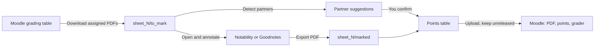

# LMU Moodle Grading Assistant

Grade Moodle submissions on your iPad with Notability or Goodnotes. Let the script handle downloads, partner detection, and uploads.

This tool is built for tutors of the **Analysis 1** course at **LMU Munich** on `moodle.lmu.de`. Students hand in solutions in pairs. Only one student uploads the PDF. The tool finds the second student, grades both, and sets you as the grader for both.

It runs fully on your iPad inside [a-Shell](https://holzschu.github.io/a-Shell_iOS/). It also runs on macOS, Linux, and Windows.

---

## Table of Contents

- [What It Does](#what-it-does)
- [How It Works](#how-it-works)
- [Requirements](#requirements)
- [📱 Installation on iPad](#-installation-on-ipad)
  - [1. Install a-Shell and the Python packages](#1-install-a-shell-and-the-python-packages)
  - [2. Put the scripts in iCloud Drive](#2-put-the-scripts-in-icloud-drive)
  - [3. Start the app](#3-start-the-app)
  - [4. Add a Home Screen icon](#4-add-a-home-screen-icon)
- [Installation on a Computer](#installation-on-a-computer)
- [🔎 Finding Your Moodle Settings](#-finding-your-moodle-settings)
- [✍️ Weekly Workflow](#️-weekly-workflow)
  - [Marking with Notability](#marking-with-notability)
  - [Marking with Goodnotes](#marking-with-goodnotes)
- [Features in Detail](#features-in-detail)
- [Command Line Interface](#command-line-interface)
- [Folder Layout](#folder-layout)
- [🔒 Privacy and Security](#-privacy-and-security)
- [Troubleshooting](#troubleshooting)
- [Development](#development)
- [License](#license)

---

## What It Does

| Step | Without this tool | With this tool |
| --- | --- | --- |
| Download | Click through the grading table, download each PDF, rename it | One tap downloads all PDFs assigned to you, with clean names |
| Find the partner | Read each header, search the course list by hand | The partner is suggested from the course roster, you only confirm |
| Upload feedback | Open each student, upload the annotated PDF | All annotated PDFs are uploaded in one batch |
| Enter grades | Type the points for both students, set yourself as grader | Points and grader are set for both students at once |

Grades stay **unreleased**. Students see nothing until you or the course team release the grades on Moodle.

---

## How It Works



The app is a small web page served on `127.0.0.1` by a Python script. On the iPad, it opens inside a-Shell's built-in browser. Nothing is exposed to the network.

---

## Requirements

- An LMU account with tutor (grading) rights in the Moodle course.
- **iPad:** the free app [a-Shell](https://apps.apple.com/app/a-shell/id1473805438), plus Notability or Goodnotes.
- **Computer:** Python 3.9 or newer.
- Python packages from [`requirements.txt`](requirements.txt): `requests`, `beautifulsoup4`, `pypdf`, `certifi`.

---

## 📱 Installation on iPad

### 1. Install a-Shell and the Python packages

1. Install **a-Shell** from the App Store.
2. Open a-Shell and run:

   ```bash
   pip install requests beautifulsoup4 pypdf certifi
   ```

### 2. Put the scripts in iCloud Drive

1. On this GitHub page, tap **Code**, then **Download ZIP**.
2. Open the **Files** app. Tap the ZIP to unpack it.
3. Create a folder in iCloud Drive, for example `iCloud Drive/LMU_Grading`.
4. Move these four files into that folder:
   - `gui.py`
   - `cli.py`
   - `moodle_client.py`
   - `pdf_processor.py`
5. In a-Shell, run:

   ```bash
   pickFolder
   ```

   Pick the `LMU_Grading` folder. a-Shell now works inside it.
6. Save the folder under a short name:

   ```bash
   bookmark icloud
   ```

   You can list your bookmarks with `showmarks`.

> [!TIP]
> If you know git, a-Shell ships `lg2`. You can run `lg2 clone https://github.com/flyingpalli/correct.git` inside the picked folder instead of using the ZIP.

### 3. Start the app

```bash
cd ~icloud
python3 gui.py
```

The app opens in a-Shell's built-in browser at `http://127.0.0.1:8765/`.

> [!NOTE]
> You can use Safari instead. Keep a-Shell visible in **Split View** or **Slide Over**. If Safari covers the full screen, iPadOS pauses a-Shell and the page stops responding.

### 4. Add a Home Screen icon

You do not need to type commands every week.

1. Open the **Shortcuts** app. Tap **+** and name the shortcut **LMU Grading**.
2. Add the a-Shell action **Execute Command**.
3. Enter the command:

   ```bash
   cd ~icloud && python3 gui.py
   ```

4. Turn on **Open App** (sometimes called **Run in App**).
5. Open the shortcut menu and choose **Add to Home Screen**.

One tap now starts the server and opens the app.

---

## Installation on a Computer

```bash
git clone https://github.com/flyingpalli/correct.git
cd correct
python3 -m venv .venv
source .venv/bin/activate        # Windows: .venv\Scripts\activate
pip install -r requirements.txt
python3 gui.py                   # or: python3 cli.py gui
```

Your default browser opens `http://127.0.0.1:8765/`. Use `python3 cli.py gui --port 9000` to pick another port.

---

## 🔎 Finding Your Moodle Settings

You only set these once. The app remembers them in `settings.json`.

### Moodle course ID

1. Open the course on `moodle.lmu.de`.
2. Look at the address bar. It shows something like:

   ```
   https://moodle.lmu.de/course/view.php?id=48957
   ```

3. The number after `id=` is the **course ID**. Here it is `48957`, which is also the default.

### Assignment (Übungsblatt) lookup

You do not need to enter an assignment ID. The app opens the course page and finds the assignment whose title contains `Übungsblatt <N>` or `Blatt <N>`. Leading zeros like `Blatt 03` also work.

If an assignment has an unusual title, find its **cmid** by hand:

1. Open the assignment on Moodle.
2. The address looks like `https://moodle.lmu.de/mod/assign/view.php?id=2672327`.
3. The number after `id=` is the cmid. Pass it with `python3 cli.py download -s 3 --cmid 2672327`.

### Your Bewerter name

The app reads your name from your Moodle profile after login. It then keeps only rows whose **Bewerter** (allocated marker) column matches you.

If your name appears in a different form in the grading table, type it exactly as shown there into **Bewerter Name in Moodle (Optional Override)**. If the app finds no match, the error message lists every Bewerter name it saw. Copy yours from that list.

### Storage folder

This is where sheets, PDFs, and grade files are kept. Paths are relative to the folder that holds the scripts.

| Value | Meaning |
| --- | --- |
| `./sheets` | Default. A `sheets` folder next to the scripts. |
| `~icloud/sheets` | Same idea, written with the a-Shell bookmark. |
| `/Users/me/Grading` | Any absolute path on a computer. |

---

## ✍️ Weekly Workflow

The app has three cards. Work through them from top to bottom.

1. **LMU Moodle Sign-In.** Enter your LMU username, for example `ab12cdef@campus.lmu.de`. Tap the password field and pick your saved login from **Apple Passwords** with Face ID or Touch ID.
2. **Exercise Sheet & Storage Folder.** Set the **Übungsblatt Number**. Tap **Save Folder & Load Sheet**, then **Download Assigned PDFs**. The files land in `sheet_<N>/to_mark/`.
3. **Mark the PDFs** in Notability or Goodnotes. See below.
4. **Assigned Submissions, Group Partners & Points.**
   - Tap **Refresh Files**. Each student with an exported PDF shows as ready.
   - Tap **Detect Partners (PDF + OCR)**. Check each suggested partner. Fix any wrong one with the autocomplete field.
   - Enter the points. Tap **Save Partners & Points**.
   - Tap **Review & Upload to Moodle**. Optionally run **Run Dry-Run Check** first. Then tap **Confirm & Upload (Keep Unreleased)**.

### Marking with Notability

1. In the Files app, open `LMU_Grading/sheets/sheet_<N>/to_mark/`.
2. Select all PDFs. Tap **Share** and choose **Notability**, or drag them into Notability in Split View.
3. Mark the solutions with your Apple Pencil.
4. For each note, tap **Share**, choose **PDF**, then **Save to Files**.
5. Save into `LMU_Grading/sheets/sheet_<N>/marked/`. Keep the file name.

### Marking with Goodnotes

1. In Goodnotes, tap **+**, then **Import**, and pick the PDFs in `sheet_<N>/to_mark/`. Goodnotes uses the file name as the document title.
2. Mark the solutions.
3. Open a document. Tap **Share** (or the **...** menu), then **Export**, and choose **PDF**. Turn annotations **on**.
4. Choose **Save to Files** and pick `LMU_Grading/sheets/sheet_<N>/marked/`.

> [!IMPORTANT]
> The exported name must start with the original name, for example `JDoe_sheet3`. You may add a score at the end. `JDoe_sheet3_14.5p.pdf` or `JDoe_sheet3-18pts.pdf` fill in the points for you. Points you type in the table take priority.

---

## Features in Detail

### Download of assigned submissions

- Reads every page of the Moodle grading table, with sticky table filters cleared first.
- Keeps only rows where the **Bewerter** column matches you, by user ID or by name.
- Downloads each student's submitted files directly. Several PDFs from one student are merged into one file.
- Names files as `[FirstInitial][Lastname]_sheet[N].pdf`, for example `JDoe_sheet2.pdf`. Name clashes get a suffix.
- Saves a manifest with Moodle user IDs, participant IDs, and folder names, so uploads can be matched later.
- Loads the **full course roster** from the grading table, the grading worksheet, and the participants page. The roster is cached per course in `course_roster_<courseid>.json` and shared by all sheets.

### Partner detection

Each pair writes both names at the top of page 1, typed or by hand, next to their 8-digit LMU matriculation numbers. The detector uses this layout.

1. **Text extraction.** It reads the PDF text layer of the top of the first pages with `pypdf`.
2. **Handwriting OCR.** In the browser, [PDF.js](https://mozilla.github.io/pdf.js/) renders the top part of page 1, including Apple Pencil strokes. [Tesseract.js](https://tesseract.projectnaptha.com/) then reads it with German and English models. On a computer with `tesseract` installed, a local OCR path is used too.
3. **Matriculation anchors.** It searches for 8-digit numbers, including common OCR mix-ups such as `O` for `0` or `l` for `1`. The text around each number is the most likely place for a name.
4. **Masking.** It removes the submitting student's own name, your name, and boilerplate words such as "Übungsblatt" or "Analysis".
5. **Roster ranking.** It compares the remaining text with every student in the course roster. The score is based on normalized edit distance between name tokens. The closest student is always suggested, so you only review.
6. **Memory.** Confirmed pairs are stored in `settings.json`. Pairs usually stay the same, so later sheets are matched at once.

Some filters keep obvious wrong answers out:

- Pages that are fully typed, such as a copy of the assignment sheet, are skipped.
- The lecturer and the assistants (**Peter Müller**, **Tamás Makai**, **Margherita Ferrero**) are never suggested.

You can always overwrite a suggestion. The partner field autocompletes from the course roster. A scrollable preview of the PDF header sits next to it. Turn the preview off with the toggle to save battery. Rendering stops fully when it is off.

### Upload to Moodle

For every marked PDF, the upload does the following.

| Target | Annotated PDF | Points | Grader (Bewerter) |
| --- | --- | --- | --- |
| Submitting student | ✅ | ✅ | ✅ you |
| Partner (did not submit) | ✅ | ✅ | ✅ you |

- **Partner resolution.** The partner is looked up on Moodle by user ID, participant ID, or name. This also works for partners who never submitted and who are not assigned to you.
- **Grader.** You are set as the allocated marker for both students. Your Moodle user ID is taken from your login.
- **Feedback files.** The fastest path is Moodle's bulk feedback ZIP. If that is not possible, the app falls back to batch upload and then to one student at a time.
- **Grades.** Points go into the quick grading table. German decimal commas are handled. Students who are not on the table get a single grade form instead.
- **Unreleased.** Student notifications are off. The marking workflow state is never set to "released".
- **Dry run.** The dry run checks all files, points, and partner mappings and sends nothing.

### Students graded by someone else

Sometimes a partner hands in a copy by mistake. Another tutor may grade that copy first. The app checks every student before it touches Moodle. If a student already has a grade from a different marker, that student is:

- **not** reassigned to you,
- **not** sent a PDF,
- **not** given new points.

The upload goes on for everyone else. The skipped students and their existing grades are listed in the result message and in the console. If Moodle reports an edit conflict during quick grading, the app retries one student at a time instead of stopping.

### Interface details

- Submissions are sorted alphabetically by submitting student.
- The last sheet, storage folder, course ID, and preview setting are remembered between launches.
- **Save Partners & Points** always overwrites the saved data for the current sheet with what is on screen.
- **Refresh Files** rescans the folders without a restart.
- Light and dark mode follow the system setting.

---

## Command Line Interface

Everything in the app also works from the terminal.

```bash
python3 cli.py download -s 3                  # download assigned PDFs for Übungsblatt 3
python3 cli.py detect-partners -s 3           # match partners from PDF text and OCR
python3 cli.py status -s 3                    # show local progress for sheet 3
python3 cli.py upload -s 3 --dry-run          # check the upload without sending anything
python3 cli.py upload -s 3                    # upload PDFs, points, and grader
python3 cli.py gui                            # start the graphical app
```

Useful options:

| Option | Commands | Purpose |
| --- | --- | --- |
| `--course-id` | `download` | Moodle course ID (default `48957`) |
| `--cmid` | `download` | Fixed assignment ID if the title lookup fails |
| `--marker` | `download` | Your name as shown in the Bewerter column |
| `--workdir` | all | Storage folder |
| `--marked-dir` | `upload` | Read annotated PDFs from another folder |
| `--no-prompt-points` | `upload` | Do not ask for missing points |
| `-u`, `--username` | `download`, `upload` | LMU username |
| `--port`, `--no-browser` | `gui` | Server port, and do not open a browser |

The password is always asked for at runtime and never saved.

---

## Folder Layout

```
LMU_Grading/
├── gui.py
├── cli.py
├── moodle_client.py
├── pdf_processor.py
├── settings.json                  # created on first run, no password inside
└── sheets/
    ├── course_roster_48957.json   # course roster cache
    └── sheet_3/
        ├── to_mark/               # downloaded submissions
        │   └── JDoe_sheet3.pdf
        ├── marked/                # your exported, annotated PDFs
        │   └── JDoe_sheet3.pdf
        ├── manifest_sheet_3.json  # Moodle IDs and confirmed partners
        └── grades_sheet_3.csv     # points per file
```

---

## 🔒 Privacy and Security

- Your **password is never written to disk**. It lives in memory for the login only.
- The server listens on `127.0.0.1` only. Other devices cannot reach it.
- Every state-changing request needs a per-session CSRF token.
- All Moodle traffic uses HTTPS. Requests to hosts other than `moodle.lmu.de` and the LMU login servers are refused.
- OCR runs on your device. No PDF is sent to an outside service. The browser loads the PDF.js and Tesseract.js code from public CDNs.

> [!CAUTION]
> Your `sheets/` folder and `settings.json` contain student names, matriculation numbers, and grades. Never commit them. The included [`.gitignore`](.gitignore) blocks them, along with every PDF, manifest, grade CSV, and roster cache outside `examples/`. Keep it in place if you fork the repo.

### Example data

The repo ships **fictional** sample files, so you can see the formats without real student data.

| File | Content |
| --- | --- |
| [`settings.example.json`](settings.example.json) | Sample settings. Copy it to `settings.json` if you want to preset values. |
| [`examples/sheets/`](examples/sheets/) | A complete sample `sheet_1` with blank PDFs, a manifest, a grade CSV, and a roster cache |

All names and numbers in these files are made up, for example "Max Mustermann" and "Erika Musterfrau".

---

## Troubleshooting

| Problem | Fix |
| --- | --- |
| The page stops responding on iPad | a-Shell was paused. Use the built-in browser, or keep a-Shell visible next to Safari. |
| "None matched Bewerter ..." | Copy your name from the list in the message into the Bewerter override field. |
| "Could not find 'Übungsblatt N'" | Check the course ID. Or use `--cmid` with the assignment ID. |
| A student shows no marked PDF | The exported file name must start with the original name, for example `JDoe_sheet3`. Tap **Refresh Files**. |
| Wrong partner suggested | Type the right name in the partner field and pick it from the list. It is remembered for later sheets. |
| A partner was skipped during upload | That student was already graded by another tutor. Sort this out with that tutor on Moodle. |
| OCR finds nothing | Make sure the iPad is online the first time, so Tesseract.js can load its language data. |

---

## Development

Run the test suite:

```bash
python3 -m unittest discover -s tests -v
```

Main modules:

| File | Role |
| --- | --- |
| [`moodle_client.py`](moodle_client.py) | LMU Shibboleth login, grading table parsing, downloads, uploads, grading |
| [`pdf_processor.py`](pdf_processor.py) | File naming, manifests, PDF text and OCR, partner matching, feedback ZIP |
| [`gui.py`](gui.py) | Local web server and the single-page interface |
| [`cli.py`](cli.py) | Command line interface |
| [`tests/test_grading.py`](tests/test_grading.py) | Unit tests with mocked Moodle pages |

The tool scrapes Moodle's web pages. A Moodle update may change the page layout and break parts of it. If that happens, please [open an issue](https://github.com/flyingpalli/correct/issues) with the error message. Please leave student names out of issue reports.

---

## License

© 2026 [flyingpalli](https://github.com/flyingpalli). See [`LICENSE`](LICENSE) for the full text.

- ✅ **Private and non-commercial use is free.** You may use, copy, change, and share everything in this repo for personal, educational, or other non-commercial purposes. This includes tutors grading their courses.
- 💼 **Commercial use needs permission.** Ask first before you use this software, or anything built on it, in a commercial context. You can [open an issue](https://github.com/flyingpalli/correct/issues) or contact me on GitHub.
- The software comes without any warranty. You are responsible for handling student data in line with data protection law (GDPR / DSGVO).
